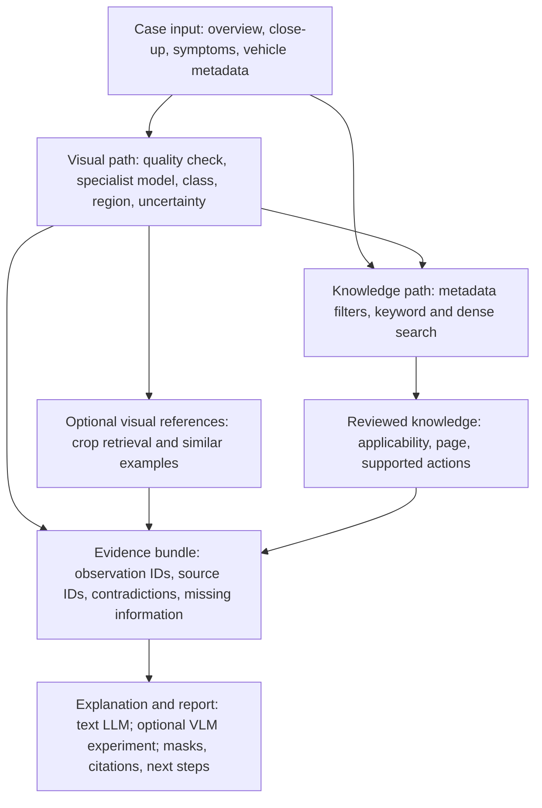

# CarDoctor: computer vision first

**Research date:** 11 October 2026. **Status:** research proposal; implementation and measurements pending.

What existing products, papers and GitHub projects teach us about visible vehicle damage, symptom retrieval and grounded explanations.

**Companion:** [CarDoctor project plan](CARDOCTOR-PROJECT-PLAN.md).

**Recommended direction:** A dedicated visual inspection component + a small, sourced knowledge base + a constrained explanation layer. Keep a VLM optional until it demonstrates a measurable benefit.

Your idea is technically coherent: a model can locate a crack or other visible defect, while retrieval finds relevant knowledge and a language model explains it. The hardest step is obtaining trustworthy visual evidence; fluent text cannot compensate for a missed defect.

This report distinguishes four things: what a camera can observe, what a model predicts, what a source supports, and what still needs inspection. It compares realistic build options without treating every available model as a required feature.

### How to use this report

The original report is reproduced in full below, with its tables restored as Markdown and its architecture redrawn as Mermaid. PDF page references in the navigation are replaced with section links.

| Read first | Then use |
| --- | --- |
| [Recommendation](#build-a-visible-inspection-then-explain-the-evidence) and [task boundaries](#what-each-component-actually-contributes) | [External evidence](#what-others-do---and-what-their-evidence-proves), repositories, models and data |
| [Visual retrieval](#useful-supporting-evidence-not-a-diagnosis-engine), knowledge, VLM and architecture | Evaluation, build sequence and reuse checks |
| [Primary sources](#primary-sources-and-implementation-references) | All 30 source references are clickable |

Prepared for MDB Vision on 11 October 2026. Research only: no training, repository execution, checkpoint download or CarDoctor accuracy measurement was performed. Web pages and code listings were inspected; third-party performance claims remain attributed.

## Build a visible inspection, then explain the evidence

**Primary proposal:** start with one exterior-damage workflow. A user uploads an overview plus a close-up; CarDoctor marks supported damage, shows uncertainty, retrieves relevant guidance and returns a cited first assessment. Add dashboard interpretation only if the core flow is already reliable.

### The smallest useful combination

**1. Perception.** Use a damage-trained detector or segmenter for a limited, documented set of visible classes. Generic car detection weights cannot be assumed to recognize cracks or scratches.

**2. Retrieval.** Search a curated, vehicle-aware knowledge base using the user symptoms plus the visual findings. Optionally retrieve similar cropped images as supporting examples.

**3. Explanation.** Have a text LLM describe the observations and evidence. A VLM can inspect ambiguous crops or read a dashboard message, but it should not silently replace the visual evidence.

**4. Decision support.** Display missing information and next steps. Keep local prices and workshop matching as sourced records, with unknown values when data is absent.

### Two feasible paths

| If this is available | Choose this path |
| --- | --- |
| A compatible damage checkpoint with clear reuse rights | Specialist detection/segmentation + text retrieval + explanation. This is the preferred CV demonstration. |
| No usable damage checkpoint or training time | Evaluate open-vocabulary localization or crop retrieval on team photos. Offer an explicitly assisted workflow if users must select the defect. Narrow the claim to what passes testing. |

**What makes the project defensible:** Show the region, its label, its evidence and the failure cases. Compare the full system with a VLM-only baseline. Owning the evaluation and integration matters more than collecting many models.

This is a research recommendation for team review, not a replacement of the recorded CarDoctor decision or an approved implementation contract. The existing multimodal-retrieval plan can remain the baseline.

## What each component actually contributes

| Task | Useful output | What it does not establish |
| --- | --- | --- |
| Detection | A box around a suspected scratch, crack or broken lamp | Exact boundaries, depth or hidden mechanical damage |
| Segmentation | A pixel mask showing the visible extent | Physical size without calibration; cost or structural severity |
| Part identification | Bumper, door, lamp, windshield; association with a defect | Exact part number from every photo or correct repair procedure |
| Visual retrieval | The most similar labelled reference crops | That the same cause exists in the uploaded vehicle |
| OCR / icon recognition | Dashboard text and candidate warning-symbol identity | The underlying fault or whether a light is only a startup self-test |
| Text retrieval + LLM | Relevant source passages and a readable explanation | Truth beyond the retrieved evidence or verified repair pricing |
| VLM | Joint interpretation of pictures and words | Reliable pixel-level defect localization without domain evaluation |
| Anomaly detection | Regions unlike a reference population of normal images | A named defect or its repair implications |

### Useful combinations, in ordinary language

**Damage inspection:** find the crack -> mark its extent -> identify the affected part -> retrieve relevant guidance -> explain what was and was not established.

**Dashboard help:** locate the illuminated symbol -> identify it or ask the user to confirm -> retrieve the correct vehicle manual -> explain the supported action.

**Fleet change tracking, later:** align comparable before/after views -> detect changes -> ask a reviewer to confirm new damage. This requires consistent capture, identity and viewpoint handling.

These are proposed workflows. Detection and segmentation are established task families; the exact combination still needs CarDoctor-specific testing. [08][s08] [09][s09] [21][s21] [23][s23]

## What others do - and what their evidence proves

### Commercial systems

**Tractable** describes training on large proprietary damage-image collections and using automotive experts to calibrate assessments. The transferable lesson is the combination of domain data and expert feedback. Its vendor article does not provide an independent benchmark for our phone-photo use case. [01][s01]

**UVeye** uses multi-angle, high-resolution capture for exterior, underbody and tire inspection, including visible windshield defects. The transferable lesson is capture quality and coverage. A controlled inspection installation is a different input environment from one casual uploaded photo. [02][s02]

### Research worth reading

**CarDD (2023)** provides a vehicle-damage benchmark with 4,000 images, over 9,000 annotated instances and six categories. It is a foundation for training/evaluation, not proof of performance in Uzbekistan or evidence of repair cost. [03][s03]

**CrashCar101 (WACV 2024)** renders synthetic damaged vehicles with part and damage masks. Its experiments demonstrate useful synthetic-to-real transfer and benefits from mixing data. This supports a later data-expansion route; building the rendering pipeline is not the shortest path to today's demo. [06][s06] [07][s07]

**TinyDamage (August 2026 preprint)** directly studies specialist segmentation feeding a VLM. In its 100-report evaluation, authors report hallucination falling from 78% with image-only input to 31% with grounding. However, only 4% of instances exceeded 0.5 IoU; the report ablation used a 9B model and was not repeated on the deployed 2B model. These results are promising evidence for decomposition, not a production-ready accuracy claim. [17][s17]

**CarDamageEval** proposes scoring structured damage/part/severity tuples alongside description quality. Its project lists AusDM 2025 acceptance, but the linked repository currently says details are coming soon. Borrow the evaluation idea; do not schedule work around code that is not released. [19][s19]

## Repositories to learn from, not blindly combine

Inspection level: README, file tree, published evaluation descriptions and licence indicators. None of these projects was installed or reproduced during this research. External model links were not downloaded.

| Repository | Useful pattern | Adoption concern |
| --- | --- | --- |
| Tarpit59 Damage + parts segmentation [13][s13] | Separate part and damage masks; tiled inference; reject implausible part/defect combinations. Weight and evaluation links are listed. | No top-level reuse licence was visible. Health scores are project rules, not validated roadworthiness. CarDD and mixed-source data rights need checking. |
| Idogur10 Damage detection and assessment [14][s14] | YOLO localization -> crop -> CLIP comparison -> lookup prices -> PDF report. | A prompt-based severity label is not a measured repair decision. Dollar tables are not local quotes; weight availability and licence remain unverified. |
| shah-suhani / WARP-26-INSPECT [15][s15] | Binary classifier -> damage segmentation -> VLM report, with separate modules. | An early "undamaged" decision can hide all downstream defects. Published scores are author claims; do not copy the no-human-inspector promise. |
| mounist / vehicle-damage-detection [16][s16] | Two-stage training and explicit discussion of evaluation gaps. | The author describes mixing clean and damaged images from different sources: a risk of learning photography style instead of damage. |
| 99anjalipai / Segment-Damage [18][s18] | Research baseline connecting segmentation, prompts and report generation; MIT repository. | Paper limitations still apply. Code licensing does not grant CarDD data rights. |
| CarDD official code [05][s05] | Task-specific training and evaluation scripts; useful taxonomy reference. | Legacy Python/PyTorch stack. Its Model Zoo link opens general MMDetection, not a verified ready-to-use damage checkpoint. |

**Recommended reuse:** learn interfaces and evaluation structure; select one visual engine. Reimplement small glue components in the team's own architecture after checking the relevant licence.

## Choose one main visual engine

| Option | Best role | Readiness / trade-off |
| --- | --- | --- |
| Damage-fine-tuned RF-DETR Seg Nano/Small [11][s11] | Candidate main segmenter when annotated data and training access exist. | Generic weights need damage adaptation. Official core Nano-Large terms are Apache-2.0; inspect the exact variant. Not an evaluated winner here. |
| Damage-fine-tuned Ultralytics segmentation [12][s12] | Fastest integration candidate if the team already has compatible, permitted damage weights. | Generic pretrained models are insufficient. AGPL-3.0 / Enterprise terms differ from permissive libraries. |
| Grounding DINO + SAM 2 [08][s08] [09][s09] | Open-vocabulary boxes followed by masks; annotation assistance or a no-training baseline. | A box must be correct before SAM can help. Thin defects may be missed; more components and runtime cost. |
| SAM 3 [10][s10] [30][s30] | Text/visual-prompt concept segmentation in one foundation model. | Worth benchmarking as a current alternative. Custom SAM License; a general segmentation capability is not proof of crack accuracy. |
| DINOv2 or CLIP [21][s21] [22][s22] | Crop retrieval, similarity-based baselines and visual references. | Embeddings are not defect masks. Choose one first and evaluate nearest-neighbor errors. |
| Anomalib / PatchCore [23][s23] | Later controlled fleet inspection using a normal reference distribution. | Free-form phone views change lighting, pose and background; anomaly scores need domain calibration. |

**Selection rule:** Prefer a model you can legally obtain, run in the hosted environment and validate on fresh photos. If two models perform similarly, choose the simpler deployment. Do not add SAM merely to produce an attractive overlay.

Published COCO throughput and accuracy numbers are deliberately not ranked here: they do not measure CarDoctor defects or the team's actual end-to-end latency.

## Cracks are a demanding first target

A "crack model" must match the material and capture conditions: cracked plastic, damaged paint and broken glass are different visual problems. A model trained on pavement or concrete cracks should be treated as a domain-transfer experiment, not a ready vehicle inspector.

### Proposed perception pipeline

**Keep both views.** Request one overview for part context and one focused close-up for the suspected defect. Preserve the original image and record every resize/crop transform.

**Check whether the input is usable.** Detect extreme blur, tiny subject size and badly clipped exposure. When evidence is insufficient, request another photo instead of forcing a class label.

**Compare full-frame and tiled inference.** Tiles can preserve small features that disappear when the whole image is resized. Merge overlapping predictions in original coordinates; test context loss and added latency. SAHI provides tooling for sliced prediction. [24][s24]

**Associate a defect with a part.** Use a part mask or ask the user to confirm the panel. A defect-mask/part-mask overlap may describe visible area, but it is not a physical depth or repair-cost measurement.

**Expose uncertainty.** Use "possible crack" or "unable to confirm" when appropriate. Panel seams, reflections, shadows and scratches belong in the negative test set.

### Do not convert pixels into unjustified severity

A larger image mask does not necessarily mean a more expensive or more dangerous repair. Viewpoint changes projected area; internal damage may be invisible. Keep visible extent, model score and repair assessment as separate fields.

**A better first milestone:** Demonstrate reliable localization of a small supported class set, then report per-class misses. If hairline cracks fail, make them an explicit unsupported case while improving the data. Do not hide the failure inside an average score.

The fine-grained grounding problem is directly discussed in the TinyDamage preprint; the capture and evaluation procedure above is our proposed response, not a reproduced result. [17][s17]

## The data determines what you can promise

| Source | What it gives | What still needs work |
| --- | --- | --- |
| CarDD [03][s03] [04][s04] | Dent, scratch, crack, glass shatter, lamp broken and tire flat annotations. | Prior consent is required; commercial use and redistribution need authorization. No supplied repair invoice, model-specific diagnosis or Uzbek price truth. |
| Team-collected vehicle photos | A relevant local test set and clean negatives under real capture conditions. | Permission, grouped splits, independent labels and coverage of different vehicles, surfaces, light and cameras. |
| CrashCar101 [06][s06] [07][s07] | Synthetic part/damage images and procedural generation code. | Real-photo testing remains essential. MIT code does not settle source-asset or rendered-dataset rights. |
| Dashboard study [28][s28] | Evidence that icon localization/classification is a viable separate task. | The abstract reports 18 classes and F1 0.91 for the top 15, not all 18. Public usable weights/data were not verified. |
| Owner manuals [29][s29] | Manufacturer-authored descriptions and actions tied to a vehicle family. | Confirm model/year/market/edition, extract page references and verify reuse terms; this is knowledge, not a visual training set. |

### A practical annotation record

For each image: permission/source, vehicle-group ID, capture date, viewpoint, quality, visible damage class, box or mask, part label, annotator and review status. For normal images, record that they were reviewed rather than assuming "no labels" means no damage.

Split by vehicle or incident before cropping and augmentation. Near-duplicate photos of the same defect must not appear in both reference/training material and the final test. Keep a separate set of confusing clean surfaces.

**Keep the first scope narrow:** Exterior damage is the primary candidate. Dashboard symbols can be a later second workflow. Smoke, fluid identity, engine noise, exact pricing and a complete vehicle health score each require different evidence and should not be bundled into an untested first release.

## Useful supporting evidence, not a diagnosis engine

DINOv2 provides general image features and supports nearest-neighbor retrieval. CLIP compares images and text in a shared representation. Both are reasonable baselines for a small visual reference library, but neither automatically turns similarity into a defect diagnosis. [21][s21] [22][s22]

### A simple proposed design

**Index meaningful regions.** Store defect crops and some surrounding panel context, labelled by a reviewer. Include reference source, visible class, vehicle context and permission information.

**Retrieve crop to crop.** Search with the localized region, not only the full car. Full-image similarity can prefer the same paint color or background instead of the same defect.

**Keep the scores honest.** Label cosine similarity as similarity. It is not a calibrated probability that the vehicle has a particular fault. A large softmax score can still mean the best of several wrong labels.

**Permit no useful match.** Use a threshold selected on held-out data, and show "no reliable reference found". If the library contains only damaged cars, a clean car will still have a nearest neighbor.

**Measure the actual benefit.** Compare full-image retrieval with crop retrieval on the same held-out photos. Record top-1 and top-3 relevance with human labels and inspect confusion between seams, cracks and scratches.

### Image and text retrieval should remain distinct

Use visual similarity to find examples of appearance. Use a text retriever to find model-specific facts and instructions. Link both through a structured observation such as "possible crack on bumper"; do not search a manual by an opaque image score.

**Small-library default:** For hundreds of references, a local feature matrix and simple nearest-neighbor search can be sufficient. Add a vector service when persistence, filtering or scale requires it. Infrastructure is not the core experiment.

Recommendation: use visual retrieval as a transparent comparison panel and fallback. Keep specialist localization as the primary CV feature if a suitable checkpoint is available.

## Retrieve knowledge first; let the LLM explain it

RAG combines external retrieval with language generation. The retriever searches the knowledge base; the LLM can rewrite a query, ask a useful follow-up and explain the retrieved material. The LLM is not itself the database. [27][s27]

### Proposed retrieval sequence

**Input:** driver symptoms + vehicle make/model/year/engine if known + structured visual observations. Preserve whether each fact came from a photo, the user or a document.

**Search:** filter for compatible vehicle metadata; combine keyword search for exact symbols/codes/model names with dense multilingual retrieval for paraphrases. BGE-M3 is a candidate; its model card supports multiple retrieval modes and over 100 languages, but Uzbek automotive queries still require local testing. [25][s25]

**Combine and select:** rank fusion can combine keyword and embedding result lists without treating their raw scores as comparable. Qdrant documents this pattern; a tiny corpus can also implement fusion directly. Start without a reranker and add one only if measured retrieval errors justify it. [26][s26]

**Answer:** pass a small set of relevant excerpts with source IDs, edition/page and vehicle applicability. Require each actionable claim to reference supporting evidence. When the needed source is absent, return the gap rather than manufacture an answer.

### Build a compact, trustworthy knowledge base

Prioritize official owner manuals, licensed service information and reviewed mechanic-authored records. Chevrolet Uzbekistan hosts a Cobalt manual in Uzbek; it is a relevant starting source, but its precise applicability and extracted passages remain to be checked. [29][s29]

Suggested record fields: source URL, title, edition/date, page/section, vehicle applicability, symptom, possible causes, required confirmation, supported action and review status. Keep a timestamp and provenance for each price or workshop record.

**Keep symptoms and causes separate:** A warning symbol or a user description can justify looking up guidance. It does not uniquely identify a broken component. Follow-up questions should resolve ambiguity, and urgency must come from applicable reviewed evidence.

## Where a VLM helps - and where it adds risk

A vision-language model can examine an image and a question together. Qwen3-VL-4B-Instruct is an available Apache-2.0 candidate with an official model card. This research did not benchmark it on CarDoctor photos; its general capabilities do not establish reliable crack localization. [20][s20]

| Good candidate use | Keep out of the first trust boundary |
| --- | --- |
| Describe a marked region using an overview and crop | Inventing new confirmed defects that the perception stage did not establish |
| Read a visible dashboard message, with user confirmation when unclear | Inferring an exact mechanical failure from one warning light |
| Suggest a follow-up photo or question | Turning weak visual evidence into an exact severity, invoice or safety certification |
| Explain structured observations together with retrieved passages | Treating generated coordinates or a confidence statement as calibrated measurement |

### Three experimental arms

**A - VLM only:** raw photo and a structured-output prompt. Useful as a baseline, not the recommended final design.

**B - Specialist CV + text RAG + text LLM:** explicit localized observations and sources. Preferred starting architecture.

**C - Specialist CV + text RAG + VLM:** also give the model overview/crops and ask whether they support the observations. Keep it only if it improves factual accuracy enough to justify latency and cost.

### Make unsupported claims detectable

Return structured findings containing an observation ID, a source ID where needed, an uncertainty state and missing information. Validate field types and cited IDs in code. Check whether the cited passage actually supports the claim; a valid-looking citation alone is insufficient.

If the VLM disagrees with the segmenter, expose the disagreement as unresolved. An appealing generated explanation should never rewrite the stored masks or silently create a definitive diagnosis.

The grounded-damage preprint supports testing this separation, but does not prove all VLMs or all grounding designs become reliable. [17][s17]

## One case, two evidence paths

Original proposal diagram. Image references support appearance; source passages support factual guidance. Visual findings also help form the knowledge query. The direct visual-to-evidence arrow makes explicit that reference retrieval is optional.

### Minimum evidence contract

- **Observation:** image ID, original-image box/mask, class, model/version, score type and uncertainty.
- **Knowledge:** source ID, applicable vehicle/edition, page and supporting excerpt.
- **Answer:** claim, linked observation/source IDs, unresolved questions and supported next step.

Keep a template response if the language service fails: show the visual results and retrieved passages with their actual status. Log model/index versions so an assessment can be reproduced.

## Prove the combination is better than its parts

Proposed pilot: assemble about 60-100 reviewed photos if time and permissions allow, spanning supported defects, clean vehicles, look-alikes, difficult captures and unsupported inputs. These are planning targets, not a statistically sufficient validation study or results already obtained.

| Layer | Measure | Failure to inspect |
| --- | --- | --- |
| Damage perception | Per-class precision/recall; box or mask mAP at specified IoU; results on clean negatives | Thin cracks missed; reflections mistaken for damage; duplicate tile detections |
| Visual retrieval | Top-1 / top-3 relevance on held-out cases; no-match behavior | Same paint or scene returned instead of same defect |
| Knowledge retrieval | Recall@k against labelled relevant passages; vehicle compatibility | Wrong vehicle edition; exact warning code missed; Uzbek paraphrase failure |
| Generated explanation | Supported-claim rate; unsupported claims; citation correctness; omission rate | Fluent answer with an irrelevant citation; observation promoted into certain cause |
| Uncertainty handling | Accuracy versus coverage as the system abstains | High reported accuracy obtained by answering almost nothing |
| Deployment | Cold and warm latency; p50/p95 on enough runs; memory and real request costs | OOM, timeouts, first request weight downloads, repeated retries |

### Run comparisons with the same evidence

Compare VLM-only, CV + text RAG + LLM, and the optional VLM-assisted variant on identical cases. Compare full-image versus crop retrieval. Add a retrieval-only/template baseline to see whether generation improves usefulness without adding unsupported claims.

Freeze the test set before tuning prompts, thresholds or classes. Group by vehicle/incident and exclude reference-library duplicates. Record both stage-level and end-to-end errors: a perfect explanation of a false visual detection is still a failed case.

**Reporting rule:** Publish numerators and denominators, split definitions, model versions, hardware and examples of misses. Tiny pilot results are directional. Do not mix box AP, mask AP, F1 or someone else's benchmark into a single "accuracy" percentage.

## A focused experiment before a larger product

The repository records a 13:00 code freeze on 11 October. The sequence below is proposed planning, not a new task assignment. Start with a go/no-go check on data, weight rights and deployment hardware before spending the remaining build window on training.

| Order | Concrete output | Proceed when |
| --- | --- | --- |
| 1. Confirm the visual route | One checkpoint and its class map, provenance, licence and deployment target | Weights are obtainable and inference runs in the intended environment |
| 2. Run a small failure probe | Fresh damage, clean and confusing images; saved raw outputs | The model demonstrates useful supported classes; otherwise narrow or label an assisted mode |
| 3. Build the visible flow | Upload -> quality -> localization -> overlay -> uncertainty | Coordinates match the original photo; no result is precomputed as a live claim |
| 4. Add a compact KB | Reviewed records with vehicle metadata and source references | The relevant document is retrievable for each supported scenario |
| 5. Add grounded explanation | Structured findings, citations and missing-information handling | The output passes factual and citation review; retain template fallback |
| 6. Compare and freeze | Measured baseline comparison, recorded failures and hosted demo | The team can explain what the model does, how it was tested and its limits |

### Conditional hardware choices

**CPU-only:** prioritize one small perception model if measured latency is acceptable; precompute reference embeddings. Consider a hosted language service only after checking the actual cost and data handling.

**GPU available:** benchmark a specialist checkpoint first; add local Qwen or foundation segmentation only after measuring memory with real image sizes. No VRAM or latency guarantee is made here.

### Defer until evidence exists

End-to-end VLM fine-tuning, synthetic-data generation, a broad smoke/leak diagnosis system, full vehicle health scoring and automatic precise repair prices. Keep three customer modes as different presentations of one validated engine rather than three unrelated model stacks.

**Next team decision:** select the first supported visual class set and one deployable checkpoint. The experiment above will resolve whether direct segmentation, assisted localization or retrieval is the strongest immediate route.

## What is ready, conditional or still unknown

| Component | Observed status | Action before adoption |
| --- | --- | --- |
| CarDD data | Prior consent for research; commercial use and redistribution require authorization. [04][s04] | Obtain relevant permission; do not redistribute a mirror just because it is downloadable. |
| SAM 2 / Grounding DINO | Official Apache-2.0 materials identified. [08][s08] [09][s09] | Pin code and weights; retain notices and check dependencies. |
| SAM 3 | Custom SAM License. [30][s30] | Read the exact terms for intended use; do not inherit SAM 2 assumptions. |
| RF-DETR / Ultralytics | Licences differ by family and variant. [11][s11] [12][s12] | Record selected package, checkpoint and terms; verify training-data provenance separately. |
| CLIP / DINOv2 / BGE-M3 | MIT / Apache-2.0 / MIT for the cited general materials. [21][s21] [22][s22] [25][s25] | Do not generalize to unrelated checkpoints or specialist subprojects in the same repository. |
| Community repos and weights | Some lack a visible reuse licence; external checkpoint files were not downloaded. | Treat them as architecture references until code, weights and data rights are established. |
| Manuals, prices, workshops | One relevant official manual found; no local price corpus or verified workshop feed gathered here. | Verify edition and reuse basis. Collect dated local evidence before displaying numerical estimates. |

### Research limits and source quality

This is a targeted primary-source review, not an exhaustive systematic survey. Vendor statements show product direction; community READMEs show claimed implementations; papers give experiments within their stated setup. No source establishes CarDoctor's own performance.

The dashboard abstract was available through indexed text, while a direct revisit returned an access challenge. CarDD's large paper PDF did not load in the browser tool; its official project, repository and licence were inspected. Model checkpoints, local GPU capacity and end-to-end runtime remain unverified.

The most valuable next evidence is a reproducible small test on the team's real inputs. It will tell us more about our product than another untested model combination.

## Primary sources and implementation references

Accessed 11 October 2026. These descriptions identify what was inspected; they do not imply reproduction or unrestricted reuse. The conversion does not add new research claims or new benchmark results.

### [01] Tractable: Tech Superiority

[Open source](https://tractable.ai/tech-superiority/)

Vendor technical article, 2 Nov 2022. Proprietary images and expert calibration; vendor evidence.

### [02] UVeye: How It Works

[Open source](https://uveye.com/how-it-works/)

Vendor product page. Multi-angle vehicle inspection and visible defect categories.

### [03] Wang et al.: CarDD

[Open source](https://cardd-ustc.github.io/)

IEEE T-ITS 2023; DOI 10.1109/TITS.2023.3258480. Dataset scope and access.

### [04] CarDD dataset licensing form

[Open source](https://cardd-ustc.github.io/docs/CarDD_license.pdf)

Primary terms: prior consent, commercial authorization and redistribution restrictions.

### [05] CarDD official implementation

[Open source](https://github.com/CarDD-USTC/CarDD-USTC.github.io)

Training/inference scripts; legacy environment. Model Zoo link resolves to general MMDetection models.

### [06] Parslov et al.: CrashCar101

[Open source](https://crashcar.compute.dtu.dk/)

WACV 2024 project and paper. Synthetic part/damage segmentation and real-domain transfer experiments.

### [07] CrashCar procedural generation

[Open source](https://github.com/JensPars/CrashCar_procedural_generation)

Official MIT code; Blender pipeline. Underlying 3D assets have separate terms.

### [08] IDEA Research: Grounding DINO

[Open source](https://github.com/IDEA-Research/GroundingDINO)

Official implementation; ECCV 2024 paper arXiv:2303.05499; Apache-2.0 repository.

### [09] Meta: SAM 2

[Open source](https://github.com/facebookresearch/sam2)

Official promptable segmentation; code and checkpoints Apache-2.0, with third-party notices.

### [10] Meta: SAM 3

[Open source](https://github.com/facebookresearch/sam3/blob/main/README.md)

Text/visual concept segmentation. Custom SAM License; inspect linked LICENSE, not package classifiers.

### [11] Roboflow: RF-DETR documentation source

[Open source](https://github.com/roboflow/rf-detr/blob/develop/docs/index.md)

Official architecture and licence distinctions; core Nano-Large Apache-2.0; some Plus components PML.

### [12] Ultralytics models and licensing

[Open source](https://github.com/ultralytics/ultralytics)

Official implementation. AGPL-3.0 and Enterprise options; inspect exact checkpoint terms.

### [13] Tarpit59: car damage and parts segmentation

[Open source](https://github.com/Tarpit59/car-damage-and-parts-segmentation)

Community pipeline: parts, damage, tiles, spatial filtering, evaluation and external weight links.

### [14] Idogur10: Car Damage Detection and Assessment

[Open source](https://github.com/Idogur10/Car-Damage-Detection-and-Assessment-System)

Community YOLO + CLIP + price-table + PDF workflow; author-reported results only.

### [15] shah-suhani: WARP-26-INSPECT

[Open source](https://github.com/shah-suhani/WARP-26-INSPECT)

Community binary classifier + segmentation + VLM reporting; inspect early-exit failure mode.

### [16] mounist: vehicle-damage-detection

[Open source](https://github.com/mounist/vehicle-damage-detection)

Community two-stage project; discusses source-domain shortcut and clean-negative gaps.

### [17] Hogale, Pai and Ravi: grounded damage VLMs

[Open source](https://arxiv.org/html/2608.02470v1)

Preprint, 3 Aug 2026. TinyDamage, 100-report ablation and significant localization limitations.

### [18] 99anjalipai: Segment-Damage

[Open source](https://github.com/99anjalipai/Segment-Damage)

Linked research implementation; MIT repository. CarDD rights remain separate.

### [19] Hasan: CarDamageEval project

[Open source](https://hellojahid.github.io/paper/cardamageeval/cardamageeval.html)

Project lists AusDM 2025 acceptance; structured damage/part/severity evaluation. Linked code is a placeholder.

### [20] Qwen3-VL-4B-Instruct model card

[Open source](https://huggingface.co/Qwen/Qwen3-VL-4B-Instruct)

Official Apache-2.0 checkpoint; general vision-language model, not a verified automotive specialist.

### [21] Meta: DINOv2 model card

[Open source](https://github.com/facebookresearch/dinov2/blob/main/MODEL_CARD.md)

Official general visual features, nearest-neighbor retrieval and Apache-2.0 model description.

### [22] OpenAI: CLIP implementation

[Open source](https://github.com/openai/CLIP)

Official MIT repository. Image/text encoders and similarity-based comparison.

### [23] Anomalib

[Open source](https://github.com/open-edge-platform/anomalib)

Official Apache-2.0 anomaly-detection library; includes PatchCore and other baselines.

### [24] OBSS: SAHI

[Open source](https://github.com/obss/sahi)

Official sliced inference and error-analysis tooling; assess exact model integration support.

### [25] BAAI: BGE-M3 model card

[Open source](https://huggingface.co/BAAI/bge-m3)

Official MIT model; multilingual dense, sparse and multi-vector retrieval.

### [26] Qdrant: Hybrid Queries

[Open source](https://qdrant.tech/documentation/search/hybrid-queries/)

Official retrieval documentation, including rank fusion. Optional infrastructure for a small KB.

### [27] Lewis et al.: Retrieval-Augmented Generation

[Open source](https://arxiv.org/abs/2005.11401)

NeurIPS 2020. Combines retrieval with generation; not a vehicle diagnosis benchmark.

### [28] Giegerich et al.: dashboard warning lights

[Open source](https://www.techconnectworld.com/World2023/a.php?i=226)

TechConnect 2023 conference abstract. Indexed text inspected; direct revisit returned an access challenge.

### [29] Chevrolet Uzbekistan: Cobalt owner manual

[Open source](https://chevrolet.uz/storage/images/exp_files_uz/17/avtomobildan-foydalanish-qollanmasi-cobalt.pdf)

Official Uzbek manual located. Edition/year fit and page-level extraction still need validation.

### [30] Meta: SAM 3 licence

[Open source](https://github.com/facebookresearch/sam3/blob/main/LICENSE)

Primary custom SAM terms, dated 19 Nov 2025; distinct from SAM 2 Apache-2.0.

[s01]: https://tractable.ai/tech-superiority/
[s02]: https://uveye.com/how-it-works/
[s03]: https://cardd-ustc.github.io/
[s04]: https://cardd-ustc.github.io/docs/CarDD_license.pdf
[s05]: https://github.com/CarDD-USTC/CarDD-USTC.github.io
[s06]: https://crashcar.compute.dtu.dk/
[s07]: https://github.com/JensPars/CrashCar_procedural_generation
[s08]: https://github.com/IDEA-Research/GroundingDINO
[s09]: https://github.com/facebookresearch/sam2
[s10]: https://github.com/facebookresearch/sam3/blob/main/README.md
[s11]: https://github.com/roboflow/rf-detr/blob/develop/docs/index.md
[s12]: https://github.com/ultralytics/ultralytics
[s13]: https://github.com/Tarpit59/car-damage-and-parts-segmentation
[s14]: https://github.com/Idogur10/Car-Damage-Detection-and-Assessment-System
[s15]: https://github.com/shah-suhani/WARP-26-INSPECT
[s16]: https://github.com/mounist/vehicle-damage-detection
[s17]: https://arxiv.org/html/2608.02470v1
[s18]: https://github.com/99anjalipai/Segment-Damage
[s19]: https://hellojahid.github.io/paper/cardamageeval/cardamageeval.html
[s20]: https://huggingface.co/Qwen/Qwen3-VL-4B-Instruct
[s21]: https://github.com/facebookresearch/dinov2/blob/main/MODEL_CARD.md
[s22]: https://github.com/openai/CLIP
[s23]: https://github.com/open-edge-platform/anomalib
[s24]: https://github.com/obss/sahi
[s25]: https://huggingface.co/BAAI/bge-m3
[s26]: https://qdrant.tech/documentation/search/hybrid-queries/
[s27]: https://arxiv.org/abs/2005.11401
[s28]: https://www.techconnectworld.com/World2023/a.php?i=226
[s29]: https://chevrolet.uz/storage/images/exp_files_uz/17/avtomobildan-foydalanish-qollanmasi-cobalt.pdf
[s30]: https://github.com/facebookresearch/sam3/blob/main/LICENSE
