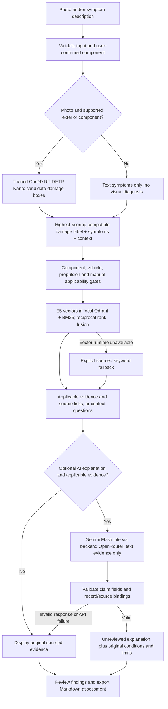

# CarDoctor current pipeline

Local implementation verified on 11 October 2026. This describes the code that runs, rather than planned features.

## Inputs and CV scope

A photo is optional when a symptom description is provided. Empty requests, malformed images and invalid context are rejected. The app supports JPEG/PNG/WebP up to 8 MB, rejects excessive dimensions, applies EXIF orientation and limits the displayed image to 2,000 pixels per side.

The exterior detector covers six damage labels: dent, scratch, crack, glass shatter, lamp broken and tire flat. Supported components are body panel, windshield, side window, lamp and tyre. Dashboard, engine, fluid, wiper, fuel and EV checks use text symptoms; their uploaded photo is a preview and is explicitly marked as not visually assessed. The app does not identify dashboard symbols or diagnose mechanical faults from pixels.

Damage boxes and scores remain unverified candidates. The user selects the component. The highest-scoring damage label compatible with that component enters retrieval; all candidate boxes remain visible. Other detected labels are not separately fused into retrieval in this version. Missing detections do not establish that a car is undamaged.

## Retrieval and generation

Canonical knowledge consists of 28 Markdown records bound to 20 sources. E5-small creates 384-dimensional embeddings; Qdrant stores them locally. Hybrid retrieval combines semantic ranking and BM25 with reciprocal rank fusion. Applicability gates require appropriate component, powertrain, exact manual and warning context. Missing facts produce questions; vehicle name alone does not confirm a manual edition.

The optional LLM sees only text symptoms/context and retrieved source evidence. Photos are not sent to OpenRouter. It can explain possible causes and next steps; generated repair costs and diagnoses must remain null. Output validation checks fields, record IDs and source bindings. These checks do not prove factual entailment or mechanic-level reliability. Original source conditions and limitations stay visible beside generated prose. Evidence is still available if the API or response validation fails.

## Results and export

The browser shows candidate regions when CV ran, the actual text-only/visual status, source-backed repair-assessment descriptions, next steps and follow-up questions. The Markdown report records user context as unverified, the confirmed manual ID, threshold, CV status, warnings/limits, retrieved evidence, generated claims/questions when available, checkpoint hash when CV ran, retrieval mode and separate stage timings.

The currently selected CarDD checkpoint has official test mAP50 0.7354 and mAP50-95 0.5916; full definitions and weaknesses are in [the measured comparison](CARDOCTOR-MODEL-COMPARISON.md). The separate VehiDE seven-class job is a research trial. Its labels cannot be loaded into the six-class app adapter without an explicit new mapping and evaluation.

## Verification and remaining limits

- 12 pipeline checks passed, including component routing, text-only no-inference behavior, unsupported-component photos, invalid-context rejection before inference, retrieval fallback, concurrency, missing-context no-paid-call behavior and export provenance.
- 9 browser checks passed with the actual CarDD checkpoint and local vector index: photo detection, source rendering, evidence-only operation, Markdown export, repair guidance, text-only symptoms, 390px layout and no JavaScript errors. The browser run made no paid LLM calls. Earlier live OpenRouter verification is recorded separately.
- The app runs locally at http://127.0.0.1:8766/. Public HTTPS deployment and final submission remain outstanding. The loopback HTTP server is not a public production gateway.

The knowledge base is small and not mechanic-reviewed. There is no calibrated severity model, automatic part detector, price estimator, workshop map, VLM or graph RAG in this build. Multilingual retrieval and field reliability have not been measured. A qualified technician must review findings before repair or driving decisions.
