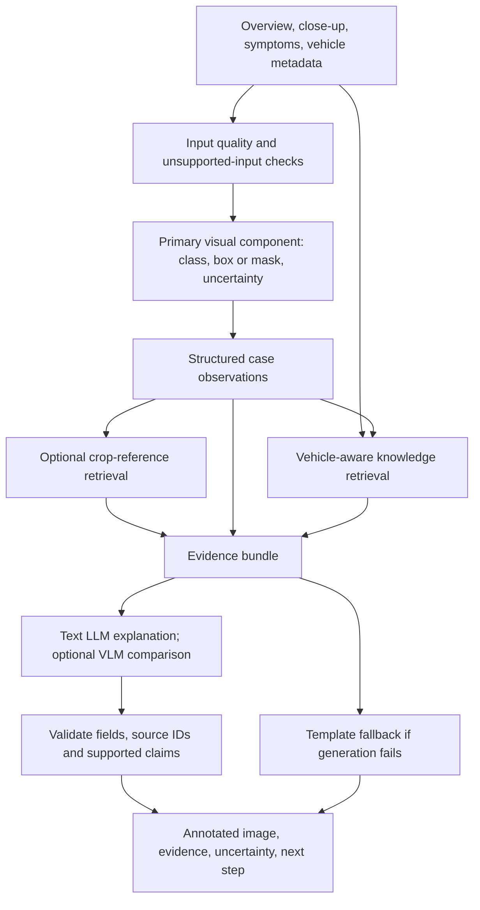

# CarDoctor project plan

**Status:** proposed plan for team review. **Date:** 11 October 2026.

**Research basis:** [CarDoctor computer vision research](CARDOCTOR-CV-RESEARCH.md), converted in full from the existing report, with 30 linked primary sources.

**Documentation format:** complete Markdown documents, including decisions, source records, experiments, results and handover notes.

This plan turns the research into a sequence of decisions and deliverables. It preserves CarDoctor's selected product concept while proposing how to strengthen its computer vision component. Model selection, datasets, training budget and interfaces remain decisions to record before implementation depends on them. The phases below are proposals, not completed work or new task assignments.

## 1. Intended first outcome

A driver uploads an overview and a close-up, describes the problem, and supplies the vehicle model if known. CarDoctor returns:

1. The visible region under consideration, with its image and location.
2. A supported damage label or an explicit uncertain/unsupported state.
3. Relevant knowledge with a source, section/page and vehicle applicability.
4. A clear explanation of what the evidence supports and what information is missing.
5. A next step supported by the available knowledge.

The first product promise is a visual first assessment of supported exterior defects. Mechanical causes, physical damage depth, exact repair costs and overall roadworthiness require additional evidence.

Used-car checking, fleet triage and accident assistance can present the same assessment engine differently. Implement one complete workflow before building three separate experiences.

## 2. Working scope and unresolved choices

| Area | Proposed starting point | Decision still required |
| --- | --- | --- |
| Visual task | Exterior damage localization, preferably segmentation when dependable | First supported damage classes and output granularity |
| Capture | Overview plus close-up, with quality feedback | Minimum usable input and retry behavior |
| Main visual model | One specialist model or a measured assisted/localization baseline | Checkpoint, framework, rights and hosting compatibility |
| Visual references | Optional crop retrieval with reviewed labels | Whether it improves understanding or measured relevance |
| Knowledge | A small reviewed corpus covering supported cases and vehicles | Initial vehicle coverage and authoritative source records |
| Explanation | Text LLM receiving structured observations and sources | Provider/model, cost budget and failure behavior |
| VLM | Optional experimental arm | Whether it improves factual output enough to justify cost |
| Training | Evaluate after measuring a baseline | Data permission, labels, compute and improvement target |
| Prices/workshops | Separate dated, sourced records when available | Local coverage, verification process and update owner |

A candidate first scope could include a few visible damage types, with cracks retained as a specific evaluation challenge. Select supported classes from actual data and results. Do not promise all CarDD categories solely because a checkpoint lists them.

## 3. Architecture proposal



Keep the stages independently observable. A visual mistake should be traceable to the visual component; a wrong manual passage should be traceable to retrieval. Save original-coordinate predictions before generating prose so the explanation cannot rewrite the visual evidence.

For a small corpus, start with simple local storage and retrieval. Introduce additional infrastructure when measured needs justify it.

## 4. Phase A: establish the baseline

### A1. Record the initial experiment

Create a short decision record containing:

- The intended user case and supported/unsupported inputs.
- The candidate classes and the definition of each label.
- Available compute, intended deployment environment and request-cost limit.
- The exact checkpoint, version and source, including the class map.
- Data and model reuse status.
- The baseline comparison and how success will be judged.

Use the existing research shortlist to evaluate one or two viable candidates rather than integrating every option. The [model shortlist](CARDOCTOR-CV-RESEARCH.md#choose-one-main-visual-engine) discusses RF-DETR, Ultralytics, Grounding DINO/SAM, embeddings and anomaly detection.

### A2. Probe obvious failures before integrating

Use fresh team photos representing real damage, clean panels, seams, reflections, difficult light and poor-quality captures. Inspect the raw localization before judging a generated report.

Record:

| Observation | Why it matters |
| --- | --- |
| Correct label but wrong region | Classification knowledge does not establish localization |
| Good large-damage results but missed fine cracks | Scope needs a per-class qualification |
| Damage detected on clean panels | Negative examples and thresholds need attention |
| Good results only on internet-style images | Local capture conditions may differ from training data |
| Slow inference or memory failures | A good offline result may still be unsuitable for the deployed app |

**Exit condition:** one candidate can demonstrate useful visual evidence on supported cases in the intended environment, with documented failures. If none can, reduce scope or use an explicitly assisted workflow while improving the data.

## 5. Phase B: dataset strategy

### B1. Separate the purposes of each collection

| Collection | Purpose | Isolation rule |
| --- | --- | --- |
| Training set | Learn the visual task if fine-tuning is chosen | Augmentations and derived crops come only from training groups |
| Validation set | Select thresholds, checkpoints and training settings | Do not treat validation tuning results as final performance |
| Test set | Evaluate the selected system | Freeze it before tuning and keep its labels out of generation prompts |
| Visual reference library | Retrieve examples of appearance | Exclude test-case duplicates and photos of the same defect |
| Knowledge corpus | Supply factual, vehicle-aware guidance | Store provenance, applicability and review status for each record |

Split by vehicle or damage incident before generating crops or augmentations. Several angles of one crack belong to one group. Deduplicate near-identical photos across all collections.

### B2. Evaluate candidate data sources

- **CarDD:** a relevant source for six visible damage types. Its [official licensing form](https://cardd-ustc.github.io/docs/CarDD_license.pdf) requires prior consent, with additional authorization for commercial use and redistribution. Record the applicable permission before relying on a copy or mirror.
- **Team-collected photos:** useful for testing actual local inputs and, if enough reviewed labels exist, adaptation. Record permission and deliberately collect clean look-alikes as well as defects.
- **CrashCar101:** a later synthetic-data option. Its [generation code](https://github.com/JensPars/CrashCar_procedural_generation) and source assets have distinct terms. Measure results on real photographs even if synthetic data is used for training.
- **Other public or workshop data:** assess provenance, annotation quality, class compatibility, duplicates and reuse terms before mixing it with the main dataset.

No fixed image count is declared sufficient. Start with a small reviewed pilot to expose the failure modes, then expand the cases and classes that lack coverage. A larger unreviewed collection can be less useful than a smaller, relevant one.

### B3. Define annotation rules before collecting at scale

Record damage type, visible region, affected part where known, uncertainty and reviewer status. Distinguish a confirmed clean image from an image that has simply not been annotated. Define how to handle occlusion, panel seams, overlapping defects, tiny marks and ambiguous cracks.

A proposed image record is:

```json
{
  "image_id": "case_001_closeup",
  "vehicle_group_id": "vehicle_001",
  "incident_group_id": "incident_001",
  "source": "team_capture",
  "permission_record": "permission_001",
  "capture_view": "closeup",
  "split": "unassigned",
  "quality": "review_pending",
  "annotation_status": "review_pending",
  "visible_labels": []
}
```

This is a proposed schema example, not a record of a collected image. Final fields should be agreed with the developer and data owner.

## 6. Phase C: decide whether to train

Training is worth considering when the baseline misses important supported defects and there is a lawful, relevant labelled dataset. Begin with fine-tuning an existing architecture rather than training a foundation model from scratch.

### C1. Choose the experiment from the error

| Baseline failure | First experiment | When training becomes relevant |
| --- | --- | --- |
| Fine cracks vanish at resized resolution | Compare close-ups, resolution and tiled inference | Misses persist despite adequate input detail |
| Reflections or seams trigger false detections | Review negatives and threshold behavior | The model lacks relevant examples of confusing surfaces |
| Wrong damage class on local vehicles | Review labels and the class map | Consistent domain errors justify adaptation |
| Correct defect but wrong part | Improve part context or request confirmation | A separate part model has adequate labels and clear value |
| Incorrect manual or symptom evidence | Fix retrieval metadata, chunking and source coverage | Visual training will not resolve this failure |
| Unsupported claims in a fluent report | Improve evidence constraints and claim review | Visual training alone will not resolve this failure |

### C2. Run a reproducible fine-tuning trial

1. Choose one architecture and a version compatible with the intended runtime.
2. Save a dataset manifest with permissions, splits, class definitions and annotation versions.
3. Record the pretrained initialization and training configuration.
4. Run a small pilot to verify label alignment, class mapping, masks and prediction coordinates.
5. Use validation results to select the checkpoint and settings; choose them before final testing.
6. Compare the selected fine-tuned model with the unmodified baseline on the same held-out cases.
7. Report per-class localization results, clean-negative errors, latency and memory.
8. Keep the simpler baseline if the improvement is inconsistent or too costly to deploy.

Treat learning rate, image resolution, loss, augmentation and training duration as recorded experimental choices. Do not copy a paper's settings or benchmark numbers as evidence for this product. If small defects drive the task, inspect their results separately from large damage.

**Exit condition:** the team can show a measured improvement for the intended classes under relevant inputs, with acceptable runtime. Otherwise retain the baseline, narrow the supported scope or gather better data.

### C3. Keep VLM fine-tuning as a separate later decision

A specialist visual model and a VLM solve different problems. Fine-tuning a VLM to write polished damage reports does not automatically produce dependable localization or reliable cost estimation.

The first training effort should target the visual weakness that measurements identify. Consider VLM adaptation only when reviewed image/observation/report examples exist and the team can test both factual accuracy and localization separately. The [VLM discussion](CARDOCTOR-CV-RESEARCH.md#where-a-vlm-helps---and-where-it-adds-risk) explains the evidence for a grounded comparison.

## 7. Phase D: build the sourced knowledge workflow

Start with records for the supported scenarios. Prefer official manuals, licensed service material and reviewed mechanic-authored guidance. Match vehicle model, year, market and engine where relevant; preserve uncertainty when that metadata is missing.

Each knowledge record should include:

| Field | Purpose |
| --- | --- |
| Source ID, URL, title and edition | Trace the guidance to its origin |
| Page or section and excerpt | Let a reviewer verify the relevant passage |
| Vehicle applicability | Avoid returning guidance for a different vehicle configuration |
| Symptom/observation | Link a user case to the record |
| Possible causes and required confirmation | Keep a hypothesis distinct from an established fault |
| Supported action and review status | Control which guidance is ready to display |

Use keyword matching for exact names, symbols or codes alongside semantic retrieval for paraphrases. Test Uzbek, Russian and English queries that the product actually intends to accept; general multilingual model support is not a measured automotive retrieval result.

Keep repair-price and workshop records separate from technical guidance. Include date, locality, service type and source. Missing price evidence should produce an unavailable value. Do not add numerical ranges from a generic foreign price table.

**Exit condition:** each supported demonstration scenario retrieves a relevant, applicable source, and the team can inspect that source before generation.

## 8. Phase E: explanation and optional VLM comparison

Build the first explanation from structured observations and retrieved sources. Return an evidence-linked result with uncertainty and missing information. Validate output fields and cited IDs, then review whether the source supports the claim.

Compare the following on the same cases:

| Arm | Inputs | Purpose |
| --- | --- | --- |
| Retrieval/template baseline | Visual findings and source passages | Establish what the system can show without generation |
| VLM only | Photo and structured-output instruction | Measure the weakness/benefit of direct visual language inference |
| CV + RAG + text LLM | Localized observations and sources | Preferred initial generated-report design |
| CV + RAG + VLM | Observations, sources, overview and crops | Optional experiment for additional visual interpretation |

Preserve disagreements between models as unresolved observations. Keep a template response available if the language service fails. Evaluate missing important findings as well as added unsupported claims.

**Exit condition:** the explanation adds usable clarity while retaining source correctness and visual evidence. Include the VLM only if the comparison supports its added cost and complexity.

## 9. Phase F: integration, evaluation and release

A successful demonstration accepts a fresh supported input and carries it through the real pipeline. It shows the uploaded image, localization, source passages and uncertainty. An unsupported or unusable photo receives an appropriate state rather than a fabricated result.

### Evaluation record

| Area | Record |
| --- | --- |
| Perception | Per-class precision/recall, specified box/mask metric, clean-negative failures |
| Visual retrieval | Top-1/top-3 relevance and no-match behavior |
| Knowledge retrieval | Relevant-passage recall and vehicle compatibility |
| Explanation | Supported claims, citation correctness, omissions and unsupported claims |
| Uncertainty | Answered coverage alongside correctness; abstention reasons |
| Runtime | Environment, cold/warm latency, memory, failures and actual request cost |

Publish sample counts, split method, selected versions and failure examples alongside the scores. Decide acceptance thresholds before final testing; do not lower them after seeing test results. Small pilots provide direction rather than broad deployment proof.

Before freezing the demonstration, check the hosted environment with a fresh request, verify cold-start behavior, document the supported inputs and save a recorded backup. The repository's 11 October 13:00 freeze means the team may need to stop after the baseline/integration phase; later training remains a follow-on experiment rather than a promise to complete it within that window.

## 10. Team coordination

The current assignment records remain authoritative. This plan creates no new assignments.

| Existing responsibility | Contribution to this proposal |
| --- | --- |
| Davlatyor + own Codex: implementation and deployment | Select deployable components, integrate the evidence flow and record interfaces |
| Muhammadjon + claude-2: photos and evaluation | Prepare grouped data, annotation/provenance records, held-out evaluation and failures |
| Bexruz + codex: sourced knowledge; pitch support | Prepare reviewed knowledge records and explain data/source limitations |
| claude-1: methods review and pitch | Review claims, scope, experiments and the presentation |

Any training task needs an explicit owner, dataset access and compute budget before starting. Record accepted decisions in the existing decision process; keep this document labelled proposed until adopted.

## 11. Suggested Markdown records

The names below are proposed future documents, not files already created by this plan.

| Document | Content |
| --- | --- |
| `data/README.md` | Provenance, permission, class definitions, splits and access instructions |
| `docs/CARDOCTOR-EXPERIMENTS.md` | Baselines, candidate settings, comparisons and selection rationale |
| `docs/results.md` | Measured results, environment, failure examples and evaluation limits |
| `kb/README.md` | Knowledge-source policy, applicability, review and update procedure |
| Existing `docs/decisions.md` | Accepted model choices, interfaces and contracts |

Large datasets and checkpoints should be stored through the project's existing artifact process, with access/provenance recorded in Markdown. The research and plan can be published as text without redistributing third-party datasets.

## 12. Immediate decision checklist

- [ ] Agree on one first user workflow and candidate visual classes.
- [ ] Identify one lawful, compatible visual checkpoint or an assisted baseline.
- [ ] Confirm available compute and the intended hosting environment.
- [ ] Prepare a small, reviewed set of damage, clean and confusing inputs.
- [ ] Measure the baseline before choosing a training effort.
- [ ] Decide whether to seek CarDD permission, collect local training labels or both.
- [ ] Agree on knowledge records and the minimum observation/source contract.
- [ ] Run the integrated workflow and document its failure cases.
- [ ] Assign any later training experiment after its data and budget are known.

The first useful decision is the supported visual task and baseline. The next is whether measurements justify fine-tuning. That keeps training and datasets central to the project while giving the team a working path before every research choice is settled.

## Local implementation experiment — 11 October 2026

A separate local baseline is now implemented in [the CarDoctor prototype](../experiments/cardoctor-local/README.md), with [measured engineering results](../experiments/cardoctor-local/RESULTS.md). It includes CPU image features, user-selected regions, capture heuristics, reference ranking, duplicate and incident-group exclusion, reviewed source-note retrieval with vehicle/component filters, and Markdown export. A grouped linear-head training path is available for future labelled photos.

Twelve backend tests and eight isolated browser workflow checks passed. The review instance has three source-linked starter summaries and no real reference photos. No automotive damage model has been trained and no damage accuracy has been measured. This experiment does not complete the specialist detection, VLM, production integration or final evaluation milestones above. Its code and runtime remain local; no task reassignment, shared-source change or push was made.

## CV model and compute proposal — 11 October 2026

The [CV training plan](CARDOCTOR-CV-TRAINING-PLAN.md) compares available damage checkpoints, recommends a supervised RF-DETR Nano detection experiment, records CarDD access requirements and grouped evaluation, and compares Hugging Face Jobs with free Colab. Current HF documentation permits included PRO compute credits to cover Jobs, but the actual account balance and extra training budget are unconfirmed. No training, cloud upload, dataset/model download or paid run was started. This is a proposed extension to the agreed retrieval architecture, with no ownership or assignment changes.

## Local knowledge-base progress — 11 October 2026

The source-linked [knowledge-base guide](../kb/README.md) is now available locally, with 28 records, 20 sources, scoped offline retrieval and 16 general notes imported into the local experiment. Read the [coverage and gaps](../kb/COVERAGE.md), [LLM grounding proposal](../kb/LLM-GROUNDING.md) and [measured engineering checks](../kb/CHECKS.md). This is a T13 foundation; automotive review, missing vehicle-specific sources, local quotes and product/LLM integration remain pending. No diagnostic-accuracy claim or paid LLM execution is made.

## Local vector retrieval progress — 11 October 2026

At the human’s request, the 28 KB records are now ingested into a local E5/Qdrant text vector collection on D:. The [vector guide](../kb/VECTOR-RAG.md) documents semantic/hybrid search, explicit applicability guards, commands and the product handoff boundary. The [development results](../kb/VECTOR-RESULTS.md) show real-model outcomes and limitations; 47 engineering checks pass. The [LLM role proposal](../kb/LLM-ROLES.md) considers request extraction, query rewriting, follow-ups and grounded explanation. No LLM/VLM was invoked, no automotive model was trained, and shared product integration remains T10.

## Local OpenRouter and CarDD progress - 11 October

A bounded Gemini 2.5 Flash Lite text-explanation adapter is now implemented in `kb/`, with [full setup](../kb/OPENROUTER.md) and [actual results](../kb/OPENROUTER-RESULTS.md). Three small authorized live checks succeeded. An observation/citation boundary weakness found in the first grounded example was corrected and retested: reported observations are now application-owned, generated claims require bound KB citations, and original applicability conditions accompany the answer. 62 KB tests and 12 existing Colab-preparation tests pass. T10 product UI integration remains with its owner.

The completed CarDD download is under `D:\hakathon_wiut\datasets\CarDD_release`. The [full audit](CARDD-DOWNLOAD-CHECK.md) verifies 4,000 images, 8,740 object annotations, six categories, the original 2,816/810/374 train/validation/test split, zero detected structural issues and zero exact cross-split file duplicates. Layout conversion is required before the prepared Colab notebook can consume the original release. No GPU training or dataset/photo upload occurred.

## Colab data conversion completed - 11 October

The original CarDD release is now converted into the prepared detector layout, preserving annotation bytes and all official split membership. A reproducible six-class 64/16 smoke upload ZIP is ready on D:; [full preparation results](CARDD-COLAB-PREPARATION.md) and [complete notebook instructions/source](../experiments/cardoctor-colab/README.md) record the actual counts, hashes, authorization metadata and remaining grouping limitations. 20 local preparation checks pass. The updated notebook audits the supplied ZIP, runs a bounded two-epoch training process, saves checkpoints and provenance, and renders four smoke-validation prediction examples. No training has executed yet because browser control cannot access Colab; file upload, GPU selection and Drive authorization require the user in the browser. Nothing was pushed.
