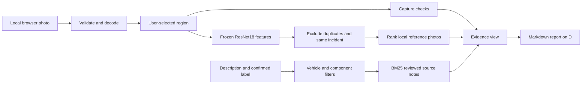

# CarDoctor local vision prototype

A working CPU prototype for the project's **photo → selected region → visual evidence → source notes** workflow. It runs on this computer and keeps model downloads, temporary files, reference images, its database and Markdown reports on **D:**.

This experiment is separate from the team's shared `src/` implementation. It has not been committed or pushed. It does not change task assignments or the agreed project architecture.

## Open it

The local address is **http://127.0.0.1:8765**. If the server is already running, open that address in a browser.

To start it yourself in PowerShell:

```powershell
Set-Location D:\hakathon_wiut\finals\mdb-vision-finals\experiments\cardoctor-local
.\start.ps1
```

Keep that terminal open; press Ctrl+C to stop the foreground server. The launcher uses the existing Python environment at `D:\hakathon_wiut\.venv\Scripts\python.exe`. It sets download and temporary directories on D: before starting Python. No dependency installation is needed on this machine.

If port 8765 is already occupied by the background instance left for review, use `stop.ps1` first. It stops only the recorded CarDoctor process after checking its executable and script path.

## Try it in five minutes

1. Choose a car photo that you own or have permission to use. The image must be JPEG, PNG or WebP, no larger than 8 MB and 16 megapixels.
2. Drag over a visible detail. The selected rectangle is mapped to original image coordinates. Click **Use whole image** to reset it.
3. Choose the component for source notes and describe what you see. Try `Windshield` with `glass crack`, or `Tire / wheel` with `sidewall bulge`. Three source-linked research summaries are already available.
4. Click **Find similar evidence**. You receive capture-quality feedback, reference matches if eligible photos exist, and matching reviewed knowledge notes.
5. Click **Save Markdown on D:** to create a report in `.runtime/reports/`. Export is performed by the server; it does not use the browser's default Downloads folder.

The reference library starts empty. This is deliberate: no unlicensed damage dataset or synthetic damage examples are presented as real evidence. Add a reviewed photo using **Add this photo as a reference**, including its visible label, source, permission basis and vehicle/incident group. Then inspect a different photo from a different incident to try visual comparison. Uploading a saved reference again excludes that exact image rather than producing a misleading self-match.

## What works

| Capability | Implementation | Meaning of the output |
| --- | --- | --- |
| Capture checks | Image dimensions, edge variance, dark and bright pixel fractions | Heuristic feedback about the selected region, not a calibrated damage assessment |
| Region selection | User draws a rectangle; server validates coordinates and minimum size | Manual localization, not automatic crack detection |
| Visual features | ImageNet-pretrained ResNet18 on CPU; 224-pixel letterbox input; 512-dimensional normalized features | General image representation, not a specialist automotive model |
| Similar references | Cosine similarity over reviewed local reference features | Ranking of examples; scores are not probabilities |
| Duplicate exclusion | SHA-256 of decoded RGB pixels and dimensions | Same decoded image is excluded, including a different crop of that image |
| Incident exclusion | Exact group-ID match, supplied by the user | Images from the same labelled incident can be excluded from comparison |
| Knowledge retrieval | Local BM25 over reviewed titles, tags and note text | Source notes relevant to the supplied description and confirmed label |
| Applicability filtering | Exact vehicle name and component match for scoped notes | Incompatible scoped notes are excluded; generic notes remain eligible |
| Reporting | Markdown generated from a fresh server analysis | Local, source-linked record with limitations and reproduction details |
| Future classifier training | Frozen features plus a trainable linear classification head | An experimental classification path once independent labelled groups exist |

A retrieved reference label is never automatically treated as a finding in the query photo. Knowledge retrieval uses the user's description and optional confirmed label. The interface shows the original reference photo and, where applicable, its selected region coordinates.

Model-specific notes require the exact vehicle name, ignoring case. `Cobalt` and `Chevrolet Cobalt` are not aliases in this prototype. When no vehicle is supplied, model-specific notes are excluded. Component-specific notes require the corresponding component selection; when it is unspecified, only generic notes are eligible.

## What has not been built or measured

- Automatic object detection, crack segmentation, depth or severity estimation.
- A trained automotive damage model or validated real-world damage accuracy.
- An LLM, VLM or generated repair diagnosis. Notes are retrieved and displayed with their sources.
- Reliable reject thresholds for visually unrelated reference examples. The top examples are a comparison aid only.
- Repair-price prediction, hidden-damage inference or a legal roadworthiness decision.
- Per-user authentication, cloud hosting, production deployment or persistence in GitHub.
- Image deduplication robust to resizing, compression changes, different camera angles or near-duplicate frames.

The source summaries in `STARTER-NOTES.md` and `seed_knowledge.py` are small research starters. They require team review before product integration. They do not supply Uzbek regulations, local prices or vehicle-specific repair procedures.

## Architecture



`core.py` owns image validation, feature extraction, SQLite storage and retrieval. `server.py` serves a small standard-library HTTP API. `static/` contains the browser interface. `reports.py` writes Markdown. `train.py` implements the future linear-head experiment. The pretrained feature extractor is shared between retrieval and that training path.

The server binds only to `127.0.0.1:8765`. Mutating API calls require a per-process token and expected host header. Uploaded images are decoded and stored as new PNG files without original EXIF metadata. Query images are processed in memory and are not stored unless explicitly added as references. Reports contain textual results, not the uploaded photo. The app uses local resources, with external source links opening only when requested.

## Train after adding labelled photos

This machine has CPU-only PyTorch and about 15 GB RAM. Training a linear head on existing feature vectors is practical; training a large detector or VLM here is a different workload. Start by verifying labels and image reuse rights.

The training command requires at least two classes and at least three independent vehicle/incident groups per class. This is a software guard, **not enough evidence by itself for a useful automotive model**. Multiple photos of the same vehicle in the same damage incident must share a group ID. For vehicle-held-out evaluation, keep all incidents belonging to the same vehicle in the same group too; the software relies on the group IDs you supply. The same decoded image under multiple group IDs causes training to fail.

Add reference photos with labels such as a narrowly defined visible defect category. Avoid making severity or repair-cost labels from unsupported guesses. Do not add final test images to the reference or training library. Keep a separate manifest of final test vehicle groups and source permissions outside the development library.

```powershell
Set-Location D:\hakathon_wiut\finals\mdb-vision-finals\experiments\cardoctor-local
$env:PYTHONDONTWRITEBYTECODE='1'
$env:TEMP='D:\hakathon_wiut\finals\mdb-vision-finals\experiments\cardoctor-local\.runtime\tmp'
$env:TMP=$env:TEMP
& D:\hakathon_wiut\.venv\Scripts\python.exe train.py --epochs 150 --seed 42
```

The command separates whole incident groups into training and development validation, trains a linear head, and records accuracy, macro F1, a confusion matrix, group IDs and settings. Runs are saved under `.runtime/training/`. The pretrained backbone remains frozen.

By default, the trained head does not become active in the app. After reviewing the data and validation report, `--activate` copies the head into `.runtime/linear_classifier.npz`; the app then displays its experimental scores alongside retrieval results. These scores are uncalibrated. The head predicts a label for the supplied region and does not find a region automatically. Delete the active head file to deactivate it. Preserve the training report for each model version.

Development validation is not a final test. No final automotive test, calibration study or claim of specialist accuracy has been completed. Optimizer and serialization were checked with explicitly synthetic toy vectors; those results are engineering checks only and are stored in isolated test directories.

## Reproduce the checks

Backend suite:

```powershell
Set-Location D:\hakathon_wiut\finals\mdb-vision-finals\experiments\cardoctor-local
$env:PYTHONDONTWRITEBYTECODE='1'
$env:TEMP='D:\hakathon_wiut\finals\mdb-vision-finals\experiments\cardoctor-local\.runtime\tmp'
$env:TMP=$env:TEMP
& D:\hakathon_wiut\.venv\Scripts\python.exe test_prototype.py
```

Browser suite requires the preinstalled Chrome and bundled Playwright already present on this machine. Stop the local server first because the suite uses the same port. It creates its own isolated library and D: browser profile; it does not download Chrome.

```powershell
$env:NODE_PATH='C:\Users\Lenovo\.cache\codex-runtimes\codex-primary-runtime\dependencies\node\node_modules'
& 'C:\Users\Lenovo\.cache\codex-runtimes\codex-primary-runtime\dependencies\node\bin\node.exe' browser_test.cjs
```

The test harness redirects browser profile, browser cache and temporary files to D:. Node and Chrome are existing installed executables read from C:; this does not install or download them. This work does not change the desktop app's own cache settings.

Read `RESULTS.md` for measured results and limitations. Synthetic fixtures and QA reports stay under `.runtime/tests/` and `.runtime/ui-tests/`, separate from the active library. Runtime files, model weights and reference data are excluded by the experiment's `.gitignore`.

## Existing environment used

These installed package versions were read from the existing D: virtual environment:

| Package | Observed version |
| --- | --- |
| torch | 2.14.0+cpu |
| torchvision | 0.29.0+cpu |
| numpy | 2.5.2 |
| Pillow | 12.3.0 |
| opencv-python | 5.0.0.93 |

The HTTP server, database access and unit-test runner use Python's standard library. Moving to another machine requires a compatible environment; the scripts are intentionally configured for this Windows computer and D: storage. The shared repository requirements file was not changed for this isolated experiment.

## Storage and model provenance

The only model download performed for this build is `resnet18-f37072fd.pth`, **46,830,571 bytes** (about 44.7 MiB), saved under `.runtime/cache/torch/checkpoints/` on D:. No package installation or dataset download was performed. Setup used the official torchvision URL and verified its advertised SHA-256 prefix.

Full file SHA-256:

```text
f37072fd47e89c5e827621c5baffa7500819f7896bbacec160b1a16c560e07ec
```

If weights are absent, `setup_model.py` downloads them to D: and checks the `f37072fd` hash prefix. Ordinary analysis does not trigger a download. The model is ImageNet-pretrained; its original 1,000-class classifier is removed for feature extraction. [Official torchvision ResNet18 documentation](https://docs.pytorch.org/vision/stable/models/generated/torchvision.models.resnet18.html)

Torchvision code uses the BSD 3-Clause license. The code license should not be treated as a blanket license for ImageNet images, future damage datasets or arbitrary downloaded checkpoints. Check applicable data and model terms before sharing derived assets. This prototype keeps weights local rather than adding them to the repository. [Torchvision license](https://github.com/pytorch/vision/blob/main/LICENSE)

All mutable prototype paths must resolve to D:; the core rejects another drive for its runtime directory. Source code, scripts, downloaded weights, reports and reference photos are separate, so publishing the Markdown and code need not publish photos or model binaries.
