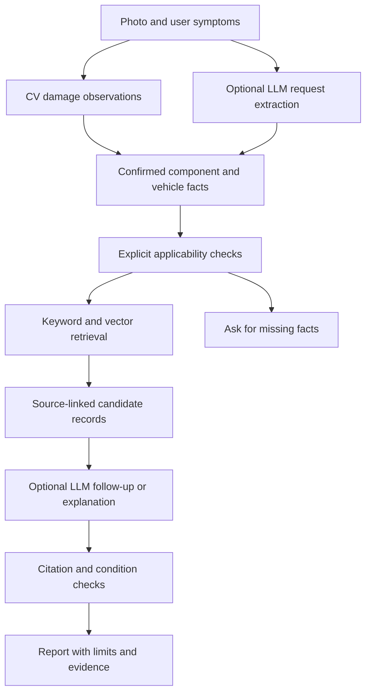

# Proposed LLM roles in CarDoctor

The product combines computer vision, retrieval, explicit applicability checks and language models. RAG is one part of that system. A vector database stores and searches embeddings; an embedding model produces them; an LLM may interpret language, plan a bounded search, ask questions and explain retrieved evidence. These roles should be evaluated separately.

This document is a proposal for the product developer. The vector experiment in `kb/` implements ingestion and retrieval, plus an LLM-ready context payload. No conversational LLM or VLM is executed here, no shared product interface is changed, and no inference credits are spent.

## Role map

| Place in the workflow | Possible LLM/VLM contribution | Required boundary | Current status |
|---|---|---|---|
| Understanding the request | Extract reported symptoms, requested mode and language into structured fields | Preserve user wording; unknown fields stay unknown; never invent model year, powertrain or engine state | Proposed |
| Forming the search | Rewrite colloquial symptoms into search phrases or produce a translation | Retain the original query; do not invent symptoms; compare retrieval with/without rewriting | Proposed |
| Interpreting an image | A VLM may provide additional observations or suggest a part when the CV detector is uncertain | Label as unconfirmed; compare with CV/user facts; require confirmation for safety-critical component ambiguity | Proposed, separately evaluated from CarDD |
| Asking follow-ups | Choose a useful question from unresolved record conditions | Deterministic vehicle/manual/powertrain/engine-state gates remain authoritative | Proposed; current retriever supplies missing-context questions |
| Explaining evidence | Explain applicable source summaries in the user's language and produce a structured report | Preserve conditions, separate observations from causes, cite bound records/sources, no unsupported costs | Proposed; current CLI can prepare evidence context |
| Checking the answer | A second model may flag unsupported claims or citation mismatches | Not proof of correctness; retain deterministic citation-ID checks and human automotive review | Optional future evaluation |

## Suggested sequence

A query-planning LLM may suggest a component, but its suggestion must not silently become a confirmed fact. For example, do not set `engine_running=true` because it sees warning lights; a key-on lamp test can look similar. Do not convert a model name into a powertrain or a manual edition.

## Proposed input contract

Keep separately:

- User facts: statements with their origin and confirmation status.
- CV observations: label, region, model version and uncertainty. A damage label is not a cause or a roadworthiness verdict.
- LLM suggestions: proposed query terms/components, not authoritative facts.
- Confirmed retrieval context: component, vehicle, powertrain, manual identity, engine state and parking-brake state when needed.
- Retrieved evidence: canonical K-IDs, S-IDs, source URLs/locators and all conditions/limits.

An LLM extraction result should be validated against an allowed schema before it reaches retrieval. Unknown enum values or string booleans must be rejected. Freeform reasoning should not overwrite context. The current implementation accepts explicit, typed context rather than adding an untested extractor.

## Example search interaction

User says: “There is a bubble on the side of my tyre.” CV may identify a tyre region but has no trained CarDD bulge class. The confirmed component is `tire`; a semantic query can search the user's wording directly. A planning LLM might additionally propose `sidewall bulge`, preserving the original text. The retriever returns candidates with source references. Follow-up distinguishes an outward protrusion from an inward indentation. Only applicable source guidance is then explained.

If a photo appears to show a crack but the part is uncertain, the appropriate first step is clarification. Better semantic matching is not a substitute for knowing whether it is a bumper, windscreen or tyre.

## Text and image retrieval

The new collection stores **text embeddings** only. A future visual reference collection needs image embeddings from a separately chosen and evaluated model, with reference-photo rights and vehicle/incident grouping. Different embedding spaces must not be mixed merely because their vector dimensions happen to match. Fuse retrieval results by record/reference IDs and evidence provenance, rather than adding unrelated vectors together.

A workshop search is also a separate task: query verified location/capability/brand fields. The current five contacts do not have verified coordinates or quotes. An LLM must not turn a nearby dealer contact into a confirmed repair provider or make up a price.

## Why no graph yet

Model/component/record/source relationships can be represented as ordinary metadata today. A graph could later support interconnected manuals, procedures, service history and confirmed workshop capabilities. Its edges would need sources, edition applicability and review, especially if extracted by an LLM. For the current 28 records, the local vector experiment gives us a concrete retrieval baseline before investing in graph extraction.

## Evaluation gates

Test whether query rewriting helps beyond direct multilingual embeddings. Review whether extracted facts are faithful, follow-ups resolve uncertainty, explanations preserve conditions, and every automotive claim is supported. Use real held-out cases and native Uzbek/Russian review. Keep retrieval quality, CV accuracy and answer factuality as separate measurements; combining models does not automatically improve any of them.

Relevant primary references: [RAG paper](https://arxiv.org/abs/2005.11401), [hybrid retrieval](https://learn.microsoft.com/en-us/azure/search/hybrid-search-overview), [retrieve/rerank](https://sbert.net/examples/sentence_transformer/applications/retrieve_rerank/README.html), [GraphRAG local/global query modes](https://microsoft.github.io/graphrag/query/overview/).

## What the real retrieval probes suggest

The [development results](VECTOR-RESULTS.md) show a concrete reason to test a language/query-planning role: one Russian tyre query was missed, and two multilingual examples needed lexical help to include the expected candidate. They also show a reason to test a reranker: similar bumper records had nearly equal semantic scores and opposed keyword rankings. An arbitrary ID preference in exact rank-fusion ties was corrected to preserve semantic ordering, but that rule does not establish subtype relevance. These are proposed experiments, not a demonstrated LLM improvement. A model rewrite must keep the original symptom and must not guess extra damage, applicability or engine state.

## Implemented first role

Grounded text explanation is now available as a bounded local CLI/Python OpenRouter adapter. See [implementation](OPENROUTER.md) and [actual live checks](OPENROUTER-RESULTS.md). Observation extraction, query rewriting, reranking and VLM use remain proposed; the shared product UI is unchanged.
