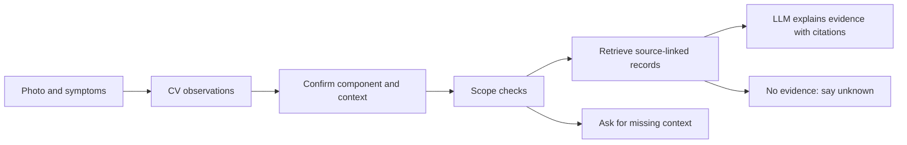

# CarDoctor knowledge base

The knowledge base supplies the evidence that turns an observation into useful guidance. The CV model may report a scratch, crack or flat tyre; it cannot, by itself, establish repairability, a hidden mechanical fault or a repair price. We retrieve relevant guidance using the component and user context, then an LLM can explain that evidence and ask for missing information.

For example, **an outward tyre-sidewall bulge** retrieves Michelin's replacement guidance. **An inward indentation** retrieves a different record. A photo labelled **crack**, without its component, asks which part is affected. A dashboard photo taken with ignition on does not establish an engine-running fault.

## Vector retrieval now available

The 28 records are now ingested into a local Qdrant database using a pinned multilingual E5 embedding model. Read the [vector guide](VECTOR-RAG.md) for ingestion/search commands, [real development results](VECTOR-RESULTS.md) for retrieval outcomes, and [proposed LLM roles](LLM-ROLES.md) for the broader CV/LLM workflow. The new integrated app at `src/app.py` uses this hybrid retrieval path with the trained damage detector and optional Gemini explanation. The earlier visual-reference experiment remains separate. See [app setup](../docs/CARDOCTOR-APP-SETUP.md).

## What is built

- **28 records**: 22 general component/powertrain records and six manufacturer-manual records. Each includes a source, applicability, possible causes, conditional urgency, repair assessment type, follow-up questions and limits.
- **20 source entries**, including manufacturer manuals, Michelin, NHTSA, 3M, I-CAR, Safelite, AA and HELLA, plus published local service/contact pages.
- **Five contact entries**: two providers publishing repair services, two dealer contacts and a manufacturer contact. Prices, coordinates, availability and telephone confirmation are absent.
- An **offline retriever**, validation checks and an idempotent adapter for the existing local prototype. No LLM, GPU, downloads or paid requests are needed to run retrieval.
- A tested OpenRouter explanation adapter and working app integration in `src/` and `web/`, added after the user explicitly requested app completion here.

The documentation and canonical records are Markdown. JSON blocks within Markdown support parsing and optional JSON export for the task's interoperability requirement. Python files are execution/test tools. No new PDFs are created.

## Files

| File | Purpose |
|---|---|
| [knowledge.md](knowledge.md) | Canonical evidence records K001-K028 |
| [sources.md](sources.md) | Source IDs, URLs, scope and rights limits |
| [workshops.md](workshops.md) | Contact directory and unfilled quote template |
| [LLM-GROUNDING.md](LLM-GROUNDING.md) | Proposed evidence-to-answer contract |
| [COVERAGE.md](COVERAGE.md) | Coverage, CarDD mapping and remaining gaps |
| [CHECKS.md](CHECKS.md) | Measured engineering checks and evaluation limits |
| [EXAMPLES.md](EXAMPLES.md) | Actual offline retrieval outputs |
| [VECTOR-RAG.md](VECTOR-RAG.md) | Local vector ingestion, hybrid retrieval, limits and run commands |
| [VECTOR-RESULTS.md](VECTOR-RESULTS.md) | Real-model development query comparison |
| [LLM-ROLES.md](LLM-ROLES.md) | Proposed LLM roles before and after retrieval |
| [retrieve.py](retrieve.py) | Standard-library retriever and exporter |
| [import_local.py](import_local.py) | Generic-note importer for the local experiment |
| [test_retrieve.py](test_retrieve.py) | Evidence isolation and validation tests |

## Run locally on D:

From `D:\hakathon_wiut\finals\mdb-vision-finals` in PowerShell:

```powershell
D:\hakathon_wiut\.venv\Scripts\python.exe -B kb/retrieve.py --validate
D:\hakathon_wiut\.venv\Scripts\python.exe -B kb/retrieve.py 'outward sidewall bulge' --part tire
D:\hakathon_wiut\.venv\Scripts\python.exe -B kb/retrieve.py 'crack' --part windshield
D:\hakathon_wiut\.venv\Scripts\python.exe -B kb/retrieve.py 'oil pressure warning' --part dashboard --vehicle Cobalt --manual S11 --engine-running yes
D:\hakathon_wiut\.venv\Scripts\python.exe -B -m unittest discover -s kb -p test_retrieve.py -v
```

`--manual S11` means someone has confirmed that the exact S11 manual applies to the vehicle's year and variant; it is not inferred from a Cobalt name. Do not set this automatically. Model-year coverage is not known from the retrieved editions.

Use `--format json` to print a structured evidence bundle for an application. To save a report, supply `--output D:\path\report.md`; the parent directory must exist. Optional `--export D:\path\knowledge.json` exports records, sources and providers for another team member's pipeline; Markdown remains canonical. Output paths outside D: are rejected. Retrieval itself is read-only and network-free.

The old local experiment already has its own packages and D: runtime:

```powershell
D:\hakathon_wiut\.venv\Scripts\python.exe -B kb/import_local.py
```

The adapter imports **16 general body, windscreen, tyre and lamp notes**. It excludes manual-specific, high-voltage, fluid and side-window guidance because the existing UI cannot reliably collect their scope/context. It does not load vision weights or change photos. Stable KB IDs make repeated imports update our own notes rather than duplicate them; existing user notes and the three legacy research starter notes are retained. The prototype may therefore show overlapping older/newer notes.

## How the pieces fit



Steps A-B are the CV workstream. This package implements scope checks and text evidence retrieval. The diagram's LLM step is a proposed integration; no LLM answer has been generated or validated here. The local prototype currently uses generic image features rather than a trained CarDD damage model.

## Retrieval contract

Inputs are a query, a confirmed component, optional vehicle/powertrain, an explicitly confirmed manual source, boolean warning-light context and an optional observed damage label. Supported components are `body`, `windshield`, `side_window`, `tire`, `lamp`, `fluid`, `dashboard`, `engine`, `wiper`, `fuel`, `ev`.

The return status is `evidence_found`, `needs_context` or `no_evidence`. Evidence bundles contain only matching records and their bound sources; prices remain null. Components are always isolated. Model names are exact (case-insensitive), with no Gentra/Lacetti or Cobalt/Cobalt MCM aliases. EV-specific records require an explicit EV/PHEV/HEV variant. Warning records requiring engine-running or parking-brake context are withheld until those facts are supplied.

The original `retrieve.py` remains a small lexical baseline using titles and curated terms, with optional label matching. The new `vector_store.py` supports semantic and BM25/vector hybrid candidate retrieval; see the vector guide for its additional status and score limitations. A relative score filter removes weak shared-word matches. Scores are **not probabilities**, diagnostic confidence or demonstrated retrieval accuracy. Results remain candidates; a higher score does not override applicability or limits. Uzbek/Russian terms are seed search terms, not a tested multilingual model.

## Remaining work

This is a working foundation, not completion of T13. A mechanic must review the guidance, the team needs permission-cleared reference/test photos, missing regional vehicle manuals must be checked, and local quotes and precise workshop locations must be obtained. Common-fault prevalence is not established by an owner's manual. Product integration and LLM quality need their own evaluation. See [coverage](COVERAGE.md) and [checks](CHECKS.md).

All work is local on D:. The vector experiment downloaded the public embedding model and installed its inference dependencies on D:. No Git push, shop contact, dataset/photo upload or GPU job was performed. Later human-authorized bounded OpenRouter calls are recorded in OPENROUTER-RESULTS.md.

## OpenRouter explanation experiment

[OPENROUTER.md](OPENROUTER.md) documents local `.env` configuration, bounded live commands, scoped text retrieval, JSON/citation checks, safe fallback and remaining review limits. [OPENROUTER-RESULTS.md](OPENROUTER-RESULTS.md) records measured live tests. The shared product UI remains separate. The downloaded CarDD release is audited in [CARDD-DOWNLOAD-CHECK.md](../docs/CARDD-DOWNLOAD-CHECK.md).
